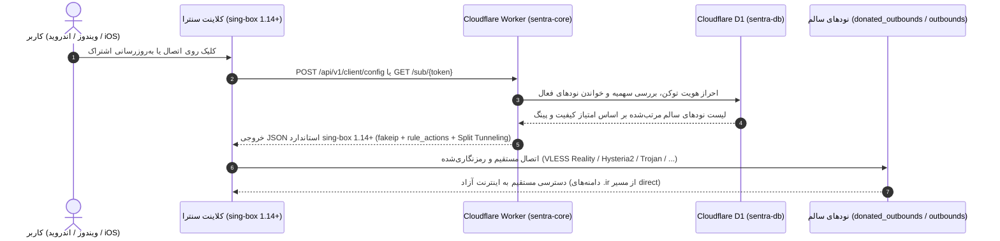
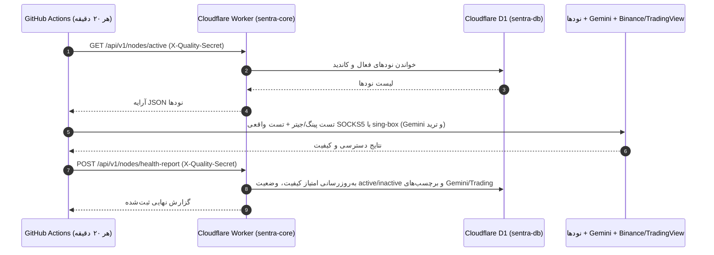

# 🏛️ معماری جامع پلتفرم سنترا (Sentra Zero-VPS Serverless Architecture)

این سند نقشه مهندسی رسمی پلتفرم **Sentra** در معماری کاملاً **Serverless و بدون VPS (Zero-VPS)** مبتنی بر **Cloudflare Workers + Cloudflare D1 + GitHub Actions** است.

---

## ۱. اصول بنیادین معماری (Core Invariants)

1. **اجرای ۱۰۰٪ بدون سرور (`Zero-VPS`):**
   - هیچ سرور واسط (Bridge VPS) یا سرور همیشه روشن لینوکسی مورد نیاز نیست.
   - تمام APIها، مدیریت اشتراک‌ها، همگام‌سازی کاربران و ربات تلگرام (به‌صورت Webhook) روی **Cloudflare Workers (`sentra-core`)** و دیتابیس **Cloudflare D1 (`sentra-db`)** اجرا می‌شوند.
2. **اتصال مستقیم کلاینت به نودهای سالم (`Direct-to-Node sing-box 1.14+`):**
   - اپلیکیشن‌های کلاینت (ویندوز، اندروید، iOS و کلاینت‌های سازگار با sing-box) از طریق اندپوینت‌های `GET /sub/{token}` و `POST /api/v1/client/config` کانفیگ استاندارد `sing-box 1.14+` شامل لیست نودهای سالم (`donated_outbounds` و `outbounds`) را دریافت کرده و مستقیماً به آن‌ها متصل می‌شوند.
   - کامپایلر Worker تضمین می‌کند:
     - تزریق اجباری `utls: { enabled: true, fingerprint: "chrome" }` برای تمامی نودهای Reality (یا حفظ `fp` مشخص‌شده در لینک).
     - استفاده از `type: "fakeip"` در `dns.servers` و `rule_actions` (`sniff` و `hijack-dns`) به جای `dns-out`.
     - حفظ Split Tunneling برای دامنه‌های `.ir` و بانک‌های ایرانی (`direct`).
     - حذف کامل کلیدهای منسوخ `independent_cache` و `_sentra_meta`.
3. **پایش مستقل کیفیت نودها در GitHub Actions (`QualityEngine`):**
   - هر ۲۰ دقیقه ورک‌فلو `.github/workflows/quality-engine.yml` به‌صورت کاملاً مستقل در محیط GitHub Actions اجرا می‌شود، لیست نودها را از `GET /api/v1/nodes/active` می‌خواند، سلامت اتصال، پینگ، جیتر، امنیت پروتکل و دسترسی واقعی به **Google Gemini** و **پلتفرم‌های ترید** را با `sing-box` بررسی کرده و نتیجه را به `POST /api/v1/nodes/health-report` ارسال می‌کند.
4. **تفکیک حالت‌های اتصال و سهمیه‌ها:**
   - **وب‌گردی (`web_browsing`):** ۲ گیگابایت روزانه برای پلن رایگان (`Sentra Lite`).
   - **دانلود (`download`):** ۳ گیگابایت روزانه برای پلن رایگان.
   - **گیمینگ (`gaming`):** به‌صورت خودکار پس از افزودن نود گیمینگ فعال می‌شود؛ برای iOS پروفایل WireGuard ارائه می‌گردد.
   - **آی‌پی ثابت (`static_ip`):** ویژه پلن‌های Pro و Flow+ (سقف ۳۰ گیگابایت ماهانه با نودهای تاییدشده برای Gemini و ترید).

---

## ۲. نقشه درختی فایل‌ها (Directory Structure)

```text
sentra-platform/
├── ARCHITECTURE.md                         # همین مستند (معماری Zero-VPS)
├── README.md                               # راهنمای سریع راه‌اندازی و دیپلوی
│
├── cloudflare-worker/                      # هسته مرکزی Serverless (TypeScript + Wrangler + D1)
│   ├── package.json                        # اسکریپت‌های تست، typecheck و deploy
│   ├── tsconfig.json                       # پیکربندی strict TypeScript
│   ├── wrangler.toml                       # نام Worker (sentra-core) و اتصال D1 (sentra-db)
│   ├── schema.sql                          # اسکیمای D1 بدون PRAGMA و TRIGGER
│   ├── migrations/
│   │   └── 0001_initial_schema.sql         # فایل مایگریشن همگام با schema.sql
│   └── src/
│       ├── index.ts                        # ورودی fetch Worker + هدرهای امنیتی و CORS محدود
│       ├── types.ts                        # تایپ‌های Env، جداول D1 و مدل گزارش سلامت
│       ├── security.ts                     # PBKDF2-SHA256، مقایسه امن کلیدها و اعتبارسنجی آدرس‌ها
│       ├── outboundAnalyzer.ts             # پارسر لینک‌ها، uTLS اجباری Reality و اثرانگشت SHA-256
│       ├── singboxCompiler.ts              # کامپایلر کلاینت sing-box 1.14+، ساب V2Ray و WireGuard iOS
│       ├── telegramWebhook.ts              # ربات تلگرام Webhook-based با مدیریت وضعیت در telegram_states
│       ├── routes.ts                       # مسیریابی REST API، سابسکریپشن، احراز هویت و گزارش سلامت
│       └── __tests__/                      # تست‌های واحد پارسر و کامپایلر (node:test)
│
├── .github/
│   ├── scripts/
│   │   └── quality-check.ts                # اسکریپت مستقل پایش نودها در GitHub Actions
│   └── workflows/
│       ├── deploy-cloudflare.yml           # تست، اجرای schema.sql روی D1 و دیپلوی Worker روی main
│       └── quality-engine.yml              # کرون‌جاب ۲۰ دقیقه‌ای پایش سلامت نودها
│
├── sentra-client/                          # اپلیکیشن کلاینت چندسکویی (Tauri v2 + TypeScript + Tailwind)
└── docs/                                   # مستندات طراحی، قوانین محصول و قراردادهای API
```

---

## ۳. نمودار جریان داده‌ها در معماری Zero-VPS

### ۳.۱. جریان دریافت کانفیگ و اتصال مستقیم کلاینت به نودها



---

### ۳.۲. چرخه خودکار پایش کیفیت نودها (GitHub Actions QualityEngine)



---

## ۴. دستورات تست و اعتبارسنجی محلی

```bash
# ۱. تست واحد پارسر و کامپایلر sing-box 1.14+
cd cloudflare-worker
npm test

# ۲. بررسی تایپ‌های TypeScript
npm run typecheck

# ۳. بیلد اپلیکیشن کلاینت
cd ../sentra-client
npm install
npm run build
```
