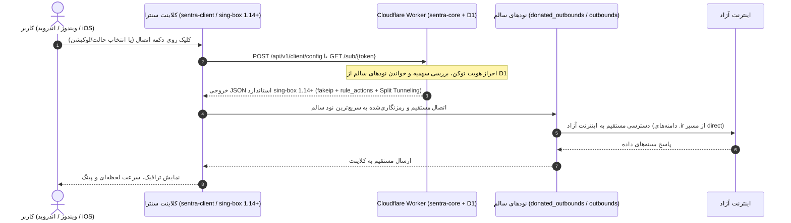
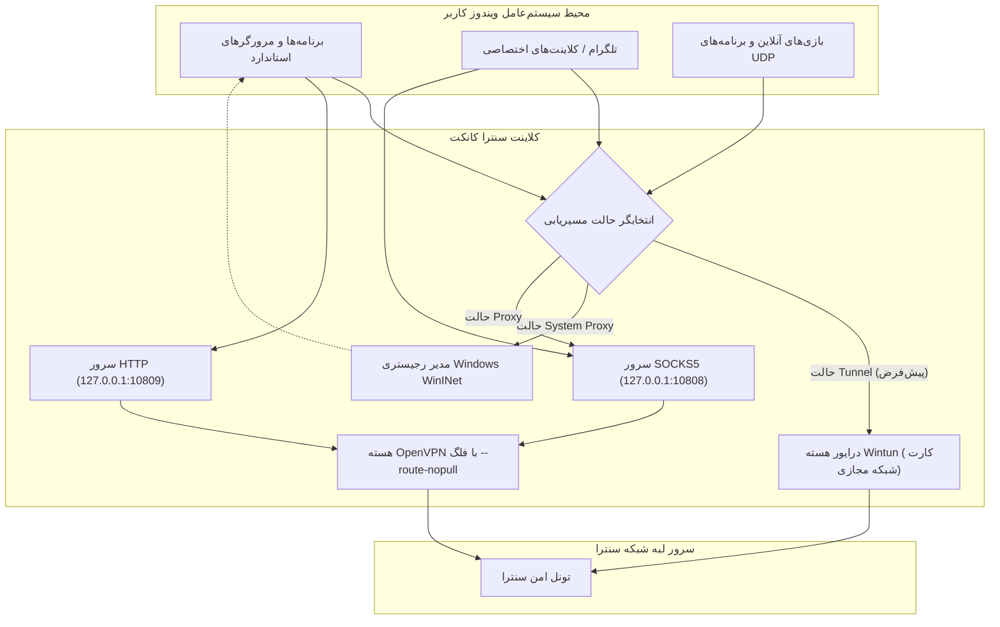

# 🏛️ معماری جامع و نقشه مهندسی پلتفرم سنترا (Sentra Architecture Specification)

این سند مرجع رسمی و فنی برای توسعه‌دهندگان فعلی و آینده جهت شناخت ساختار کد، نقشه ماژول‌ها، جریان داده‌ها و راهنمای توسعه اکوسیستم **Sentra** است.

---

## ۱. اصول بنیادین و الزامات امنیتی پلتفرم (Core Invariants)

1. **پنهان‌سازی مطلق اسرار هسته در سرور (`Zero Secret Exposure`):**
   - سرورهای بالادستی، آدرس‌های نودها، کلیدهای V2Ray/Sing-box (مانند VLESS Reality، VMess، Trojan، Hysteria 2) منحصراً در سرور (`sentra-core`) نگهداری می‌شوند.
   - کلاینت‌های عمومی کاربر (ویندوز، اندروید، iOS) هرگز به طور مستقیم به V2Ray متصل نمی‌شوند و هیچ شناسه یا کلیدی به کلاینت ارسال نمی‌گردد.
2. **پروتکل‌های ارتباطی کاربر:**
   - ارتباط کاربران با لبه شبکه سنترا تنها از طریق پروتکل‌های استاندارد **OpenVPN (UDP/TCP)**، **Stealth (تونل رمزنگاری‌شده TLS 1.3 با Stunnel)** و **IKEv2 (Native)** برقرار می‌گردد.
3. **تفکیک تجاری و ایزولاسیون سطوح دسترسی:**
   - **وب‌گردی (`web_browsing`):** ۲ گیگابایت روزانه رایگان، بهینه‌شده برای پروتکل‌های وب.
   - **دانلود پرسرعت (`download`):** ۳ گیگابایت روزانه رایگان، بهینه‌شده برای انتقال داده با ظرفیت بالا.
   - **آی‌پی ثابت مسکونی (`static_ip`):** ویژه کاربران Pro و Flow+ با دیتاسنتر اختصاصی آمریکا، حفاظت نشت IP، مسدودسازی IPv6 و قفل اجباری Kill-Switch و حالت Tunnel.

---

## ۲. نقشه درختی فایل‌ها و ساختار ماژولار (Directory Structure)

```text
SentraVpn/
├── ARCHITECTURE.md                  # همین مستند (راهنمای جامع معماری)
├── README.md                        # معرفی کلی پروژه و دستورات راه‌اندازی
├── Cargo.toml                       # تعریف Workspace سراسری Rust
├── Cargo.lock                       # قفل نسخه‌های وابستگی‌ها
├── .gitignore                       # قوانین ایمن مخزن Git (حذف باینری‌های سنگین)
│
├── docs/                            # مستندات رسمی مهندسی و تجاری
│   ├── PRD.md                       # سند مشخصات نیازمندی‌های محصول (Product Requirement Document)
│   ├── PROTOCOL_SPEC.md             # مشخصات فنی لایه شبکه و پروتکل‌ها
│   ├── SCHEMA_AND_API.md            # ساختار دیتابیس DDL و قراردادهای REST API
│   ├── MASTER_SPEC.md               # مشخصات جامع مهندسی سیستم
│   ├── RULES.md                     # قوانین تجاری و سیاست‌های سهمیه
│   └── DESIGN.md                    # اصول طراحی بصری و راهنمای رابط کاربری
│
├── sentra-core/                     # بک‌اند مرکزی، سرور API و ربات تلگرام (Rust Axum)
│   ├── Cargo.toml                   # وابستگی‌های سرور (axum, teloxide, sqlx, x25519-dalek, ...)
│   ├── migrations/
│   │   └── schema.sql               # اسکریپت ساخت جداول دیتابیس SQLite/PostgreSQL
│   └── src/
│       ├── main.rs                  # نقطه ورود سرور، پیکربندی Router، اجرای ربات و تسک‌های پس‌زمینه
│       ├── models.rs                # تعاریف ساختارهای داده (User, Subscription, Outbound, WarpAccount, ...)
│       ├── db.rs                    # استخر اتصالات و توابع کار با پایگاه داده (CRUD، مهاجرت‌ها)
│       ├── warp_gen.rs              # تولیدکننده خودکار کلیدهای Curve25519 و ثبت‌نام اکانت Cloudflare WARP
│       ├── outbound_analyzer.rs     # اسکنر امنیتی SSRF، پارسر انواع پروتکل‌ها و بنچمارک پینگ و سرعت
│       ├── worker.rs                # ورکر دوره‌ای جهت بررسی سلامت نودها و ریست سهمیه‌های روزانه
│       ├── api/
│       │   └── mod.rs               # کنترلرهای REST API (/api/v1/client/*, /auth/*, /heartbeat, ...)
│       └── bot/
│           ├── mod.rs               # دیسپچر اصلی رویدادها، پیام‌ها و کالبک‌های ربات تلگرام
│           ├── user_handlers.rs     # هندلرهای بخش کاربر (دریافت کانفیگ iOS، اهدای نود، تیکت پشتیبانی)
│           ├── admin_handlers.rs    # هندلرهای ادمین (مدیریت کاربران، تایید نودها، سابسکریپشن، برودکست)
│           └── keyboards.rs         # سازنده کیبوردهای شیشه‌ای و منوهای تعاملی تلگرام
│
└── sentra-client/                   # اپلیکیشن چندسکویی کلاینت (Tauri v2 + TypeScript)
    ├── package.json                 # وابستگی‌های فرانت‌اند (Vite, TypeScript, Tailwind)
    ├── vite.config.ts               # پیکربندی بیلد ابزار Vite
    ├── index.html                   # سند تک‌صفحه‌ای داشبورد اصلی اپلیکیشن
    ├── src/
    │   ├── main.ts                  # کنترلر منطق فرانت‌اند، اتصال به IPC و مدیریت وضعیت
    │   └── styles.css               # سیستم طراحی، پالت‌های تم و انیمیشن‌های Hyprland
    └── src-tauri/                   # بک‌اند دسکتاپ (Rust)
        ├── Cargo.toml               # وابستگی‌های بک‌اند کلاینت (tauri, tokio, reqwest, ...)
        ├── src/
        │   ├── lib.rs               # راه‌اندازی Tauri، پلاگین‌ها، چرخه‌حیات پنجره و پاکسازی پروکسی
        │   ├── commands.rs          # توابع IPC فراخوانی‌شده توسط فرانت‌اند (Connect, Protocol, Mode, ...)
        │   ├── state.rs             # مدیریت وضعیت حافظه‌ای سراسری کلاینت (ClientState)
        │   ├── vpn_manager.rs       # مدیریت پروسه هسته OpenVPN، مانیتورینگ ترافیک و بازنشانی شبکه
        │   ├── local_proxy.rs       # سرور سبک داخلی SOCKS5 (10808) و HTTP (10809)
        │   ├── sysproxy.rs          # مدیریت خودکار کلیدهای رجیستری ویندوز و نوتیفیکیشن WinINet
        │   ├── telemetry.rs         # مخابره لحظه‌ای سرعت، تاخیر، زمان اتصال و لاگ‌ها به فرانت‌اند
        │   ├── auth.rs              # ذخیره‌سازی نشست‌ها و تولید اثرانگشت سخت‌افزاری دستگاه
        │   └── sandbox.rs           # شبیه‌ساز آفلاین لوپ‌بک جهت تست سریع بدون نیاز به شبکه خارجی
        └── plugins/
            └── sentra-vpn/          # پلاگین اختصاصی اندروید (VpnService) و دسکتاپ
```

---

## ۳. نمودار جریان داده‌ها و معماری شبکه (Data Flow Diagrams)

### ۳.۱. جریان اتصال مستقیم کلاینت به نودها در معماری Zero-VPS



---

### ۳.۲. معماری ۳ حالته مسیریابی کلاینت ویندوز



---

## ۴. راهنمای توسعه‌دهندگان جهت توسعه آینده (Developer Onboarding)

### ۴.۱. نحوه افزودن پروتکل جدید به کلاینت و سرور
1. **سرور (`sentra-core`):**
   - در فایل `sentra-core/src/api/mod.rs` نام پروتکل جدید (مثلاً `wireguard_direct`) را در تابع اعتبارسنجی مجاز کنید.
   - فیلدهای لازم جهت اتصال (مانند کلیدها و آدرس شنود) را در خروجی `ConfigResponse` قرار دهید.
2. **کلاینت (`sentra-client`):**
   - در `sentra-client/src-tauri/src/state.rs` نام پروتکل را مجاز کنید.
   - در `sentra-client/src-tauri/src/vpn_manager.rs` نحوه راه‌اندازی پروسه کلاینتی آن پروتکل را تعریف کنید.
   - در `sentra-client/index.html` دکمه مربوطه را در بخش `protocols-container` اضافه نمایید.

### ۴.۲. نحوه افزودن یا تغییر تم بصری
- در فایل `sentra-client/src/styles.css`، استایل‌های تم جدید را تحت سلکتور `[data-theme="نام_تم"]` با متغیرهای استاندارد CSS تعریف کنید:
  `--bg-canvas`, `--bg-card`, `--border-subtle`, `--text-primary`, `--color-accent`.

### ۴.۳. دستورات بیلد و اعتبارسنجی سلامت کل پروژه
```bash
# ۱. اعتبارسنجی کامل کدهای Rust (بدون هشدار):
cargo check --workspace
cargo clippy --workspace

# ۲. بیلد فرانت‌اند کلاینت:
cd sentra-client
npm install
npm run build

# ۳. اجرای سرور توسعه محلی:
cd ../sentra-core
cargo run
```
